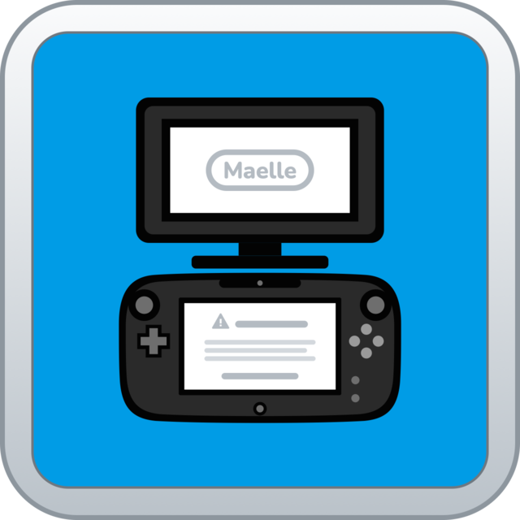

# Maelle
A DS, DSi and GBA emulator for the Wii U, which also runs Game Boy and Game Boy Color games.

### Overview
Maelle is a Wii U-only fork of [NooDS](https://github.com/Hydr8gon/NooDS) by Hydr8gon, focused on running well on real
hardware.

It's licensed under the GPL version 3, like NooDS.

What's new compared to NooDS

#### Speed
- JIT for both the ARM9 and ARM7, generating native PowerPC code, in DS and DSi mode
- GPU 3D renderer that draws with the Wii U's GPU instead of the CPU
- The emulator gets its own CPU core, with each 2D engine and 3D geometry on separate threads
- Fast CPU Timing and Fast 2D Threads options, on by default, which trade a little accuracy for speed
- Sync to Display, which runs one emulated frame per display refresh for smoother motion
- Smoother audio while games load, with smaller output buffers
- Faster memory access, 2D drawing, display capture, audio mixing, geometry processing and VRAM switching
- Screen upscaling and ghosting done on the GPU

#### GPU 3D renderer features
- High-resolution 3D
- DS-style anti-aliasing, with an optional multisampling mode
- Edge marking, fog, shadows, toon and highlight shading, wireframe, alpha test and rear-plane bitmaps

#### DSi
- The DSi menu starts, and launches DS cartridges and DSi titles
- DSiWare `.nds` files boot directly, with their saves kept next to them
- DSi-only titles start in DSi mode, whatever the settings
- DSP, with Nintendo's sound programs reimplemented in C++ after melonDS (and Teakra for any others), so DSi Sound
  plays and records, AAC files included
- SD card from an `sd.img` image, written back without freezing, so Flipnote Studio can back up to it
- NDMA and the main memory display FIFO behave as they do on a real DSi, checked with test ROMs run on one

#### Accuracy
- GBA slot accessories: Rumble Pak, Memory Expansion Pak, Guitar Grip, Easy Piano, paddle and solar sensor, with a
  Sunlight setting and hotkeys
- NAND saves for cartridges that keep them on the ROM chip, such as WarioWare: D.I.Y. and Jam with the Band
- The RTC's remaining registers, its interrupts and day of the week, and the keypad interrupt (KEYCNT)
- 3D far-plane clipping, single-dot polygon hiding, and polygon and vertex RAM overflow flags

#### Game Boy and GBA
- Game Boy and Game Boy Color games run in GBA mode through MiGoomba, built into the app, with rumble and battery saves
- GBA cartridge clock, also for Pokémon Ruby, Sapphire and Emerald hacks that add one and for Goomba Color's MBC3 clocks
- GBA rumble and solar sensor carts work with the DSi setting on too

#### ROM loading
- "Keep ROM in RAM" can load the whole ROM first, with progress and cancel, or stream it in the background
- Loading a whole ROM is over twice as fast (a 256 MB ROM went from 28 to 13 seconds)
- Restarting reuses the ROM already in memory, so there's no second load
- Reads from the SD card are cached for ROMs that aren't kept in RAM

#### Wii U support
- TV + GamePad screen arrangements, with the top screen on the TV and the bottom one on the GamePad
- The GamePad can be turned on and off during a game
- Pro Controller and Classic Controller support
- A 640x480 layout for TVs set to 4:3 in the Wii U's settings
- HOME menu support
- GamePad microphone input in DS and DSi mode, with a Blow into Mic hotkey for games that check for blowing
- GamePad camera as the DSi's cameras, so DSi Camera can take and save photos
- Headphones plugged into the GamePad are seen by DSi titles
- Right stick pointer for the touch screen, with a rebindable touch hotkey
- Game Language setting, which defaults to the Wii U's system language
- Nickname setting, which defaults to the Wii U user's Mii name and is typed with the system keyboard

#### Wi-Fi
- Online play in DS and DSi mode through the Wii U's internet connection, with an emulated access point
- Nintendo WFC games connect to replacement services such as Wiimmfi, through an editable DNS Server setting

#### Interface
- Simpler settings menu, split into tabs switched with L and R
- L and R are the DS's L and R, and ZL or ZR opens the menu; a hotkey can also take a combo of two buttons, set by
  pressing both together when remapping it
- File browser: set a default folder (Y), open a ROM's launch options (−) to run it with a chosen save type, and find the
  last ROM played already selected (can be turned off)
- Menus page with left and right, and wrap around from either end
- Pause menu rearranged, and Restart asks for confirmation
- Optional Screen Frame setting: the space around the screens looks like a DSi, in any of its eight colours, with
  working lights: wireless for Wi-Fi, and charge and power for the GamePad's battery
- Version shown in the menus, and an About screen with the build date
- A new icon

#### Fixes
- 3D alpha test and rear-plane bitmaps, which weren't emulated before, now work in the software renderer too
- Games no longer sometimes freeze after loading a state
- Fixed several rare freezes and GPU hangs, including a stall caused by Aroma's file redirection
- Bitmap mode homebrew no longer shows a single stretched pixel
- A stale object window on the first frame after the display turns back on

#### For developers
- Debug build variants for profiling, frame timing and diagnosing freezes (`build-wiiu-debug.sh`)
- Hang reports written to `hang.txt`
- Test ROMs that save how a real DS or DSi behaves, and a Mac harness that runs the core and the JIT's code headless
  (`tests/`)
- Automatic GitHub releases from version tags

### Beta software
Maelle is beta software. Most games run well, but some may still hang, crash or misbehave, and DSi mode is newer and
less tested than DS mode.

If something hangs or isn't working, try changing settings before reporting it. Turning off JIT is the first thing to
try, followed by Fast CPU Timing, Sync to Display and the GPU 3D Renderer.

When reporting a bug, include the game's name and the ROM's hash (SHA-1 or MD5), plus which settings you tried.

### Usage
Put `maelle.wuhb` in `sd:/wiiu/apps/` on your SD card. Settings, states and cheats are kept in `sd:/wiiu/apps/maelle/`, and saves next to the ROM.

Maelle used to be called NooDS U. If `sd:/wiiu/apps/noodsu/` is there, the first start moves it to `sd:/wiiu/apps/maelle/`
with everything in it, so `noodsu.wuhb` can be deleted.

Maelle should be able to run most DS and GBA games without any setup. Game Boy and Game Boy Color ROMs (`.gb`, `.gbc`)
run in GBA mode in [MiGoomba](https://github.com/michyprima/migoomba), a Goomba Color fork built into the app; their saves
are in Goomba's packed format, which MiGoomba's `tools/goombasave.py` converts.

System files go in `sd:/wiiu/apps/maelle/bios/`, and their paths can be changed in the `maelle.ini` file:
- DS BIOS and firmware (`bios9.bin`, `bios7.bin`, `firmware.bin`) are needed to boot the system menu, and can be dumped
  from a DS with [DSBF Dumper](https://archive.org/details/dsbf-dumper). The firmware must come from an original DS; DSi
  and 3DS dumps don't contain any boot code.
- DSi mode needs DSi BIOS, firmware and NAND files (`bios9i.bin`, `bios7i.bin`, `firmwarei.bin`, `nand.bin`), dumped
  from a DSi. An SD card image can be put at `sd:/wiiu/apps/maelle/sd.img`.
- A GBA BIOS file (`gba_bios.bin`) can be optionally provided, and can be dumped from many systems with
  [this dumper](https://github.com/mgba-emu/bios-dump).

Save types are automatically detected, but this may not always be accurate. If you run something
and it has issues with saving, the save type can be changed in the pause menu.

### Building
Install [devkitPro](https://devkitpro.org/wiki/Getting_Started) and its `wiiu-dev` and `gba-dev` packages, the latter
for MiGoomba. Clone with `--recursive`, or run `git submodule update --init` after cloning, then run `make -j$(nproc)` in
the project root directory to start building. `./build-wiiu-debug.sh` builds variants for debugging and measuring.

### References
* [GBATEK](https://problemkaputt.de/gbatek.htm) - The main information source for all things DS and GBA
* [GBATEK Addendum](https://melonds.kuribo64.net/board/thread.php?id=13) - A thread that aims to fill the gaps in GBATEK
* [melonDS Blog](https://melonds.kuribo64.net) - Contains posts that detail various 3D quirks
* [DraStic BIOS](https://drive.google.com/file/d/1dl6xgOXc892r43RzkIJKI6nikYIipzoN/view) - Reference for the DS HLE BIOS functions
* [Cult of GBA BIOS](https://github.com/Cult-of-GBA/BIOS) - Reference for the GBA HLE BIOS functions
* [melonDS](https://github.com/melonDS-emu/melonDS) - The base for the DSi DSP's high-level programs and the emulated access point
* [Teakra](https://github.com/wwylele/teakra) - Runs DSP programs that aren't reimplemented
* [FAAD2](https://github.com/knik0/faad2) - Decodes AAC audio for the DSP

---

*Dedicato alla mia nipotina*
